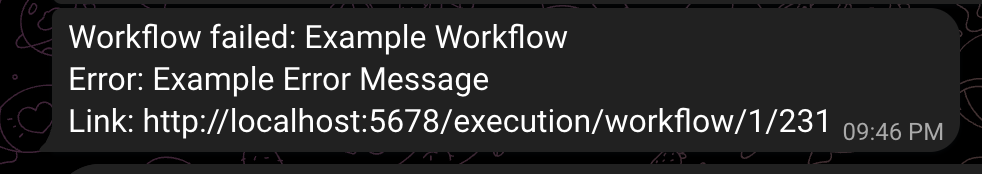

# IT Helpdesk Ticket Automation (n8n)

An n8n workflow that receives IT support requests through a form, uses a local LLM to assess urgency and suggest a first fix, logs every ticket in Google Sheets and alerts the IT team on Telegram. High-priority tickets get an URGENT alert. A separate workflow sends a Telegram alert if the main one fails.

## How it works

1. **Form Trigger** collects name, department, issue type (Internet, Hardware, Printer, Slow computer, Password reset, Software, Other) and a description.
2. **Code** creates a ticket ID and timestamp, and sets default values (priority Medium, suggested fix "Review manually") used if the LLM step fails.
3. **Basic LLM Chain** (with an Ollama model) reads the description and returns a priority (High, Medium or Low) and a short first fix. The prompt defines each priority level and includes examples.
4. **Final priority (Code)** reads the model's reply. If the reply is in the expected format, it replaces the defaults. Otherwise the defaults are kept, so a ticket is never lost.
5. **Google Sheets** appends the ticket as a row.
6. **If** checks whether the priority is High.
7. **Telegram** sends an URGENT alert for High priority tickets and a normal alert for the rest.

Error handling: a separate workflow (`error-workflow.json`) uses an Error Trigger and sends a Telegram message with the workflow name, error message and execution link when the main workflow fails.

## Files

- `workflow.json`: main workflow
- `error-workflow.json`: error alert workflow
- `screenshots/`: workflow canvas, Google Sheet, Telegram alerts and failure alert

## Screenshots

Workflow:

Google Sheet with logged tickets:

Telegram alerts:

Failure alert from the error workflow:

## Setup

1. In n8n, import both JSON files (workflow menu, then Import from File).
2. Install Ollama and pull a model, for example `ollama pull llama3.1:8b`. Select it in the Ollama Model node.
3. Create a Telegram bot with @BotFather and add its token as a Telegram API credential in n8n.
4. Create a Google Sheet with this header row in row 1: `ticket_id`, `submitted_at`, `name`, `department`, `issue_type`, `description`, `priority`, `suggested_fix`, `status`.
5. Add a Google Sheets credential, then select your sheet in the Google Sheets node.
6. Set your Telegram chat ID in both Telegram nodes and in the error workflow.
7. In the main workflow settings, set **Error Workflow** to the error alert workflow.
8. Publish the main workflow. The form is then available at its production URL.

## Customize

- Priority rules and first-fix style: edit the prompt in the Basic LLM Chain node.
- Issue types: edit the dropdown in the Form Trigger.
- Alert wording: edit the two Telegram nodes.

## Notes

- Uses synthetic test data only. No personal data is stored.
- The LLM step needs Ollama running on the same machine as n8n. To run it without a local model, replace the Ollama Model node with a hosted model.
- Model output can be wrong or badly formatted, so the workflow keeps default values and falls back to them when the reply cannot be read.
